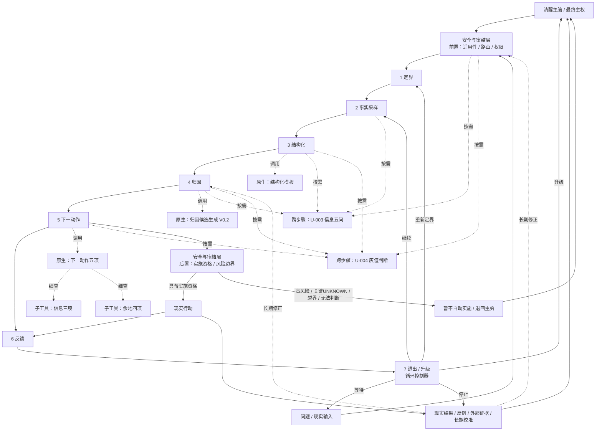

# 副躯体网络图

这一文件把“七步法 + 原生工具 + 跨步骤工具 + 安全 / 审结层 + 主脑”放到同一张网络里，而不是继续把它们硬塞成一个超级流程。

## 读图原则

- 七步法是脊柱，不是所有器官的集合；
- 原生工具“长在步骤上”；
- 跨步骤工具像独立器官 / 反射模块，可以被多个步骤调用；
- 安全 / 审结层拥有路由和自动实施资格判断，但不拥有最终主权；
- 主脑和副躯体可能共模错误，所以现实校准必须从系统外重新进入。
